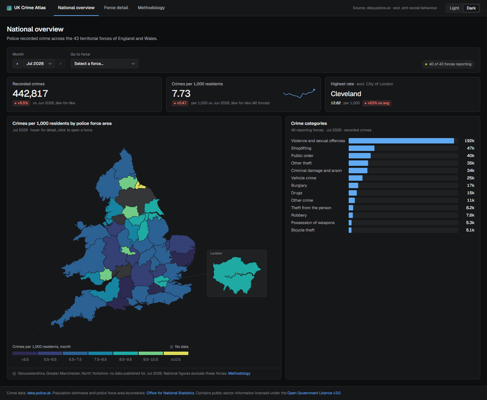
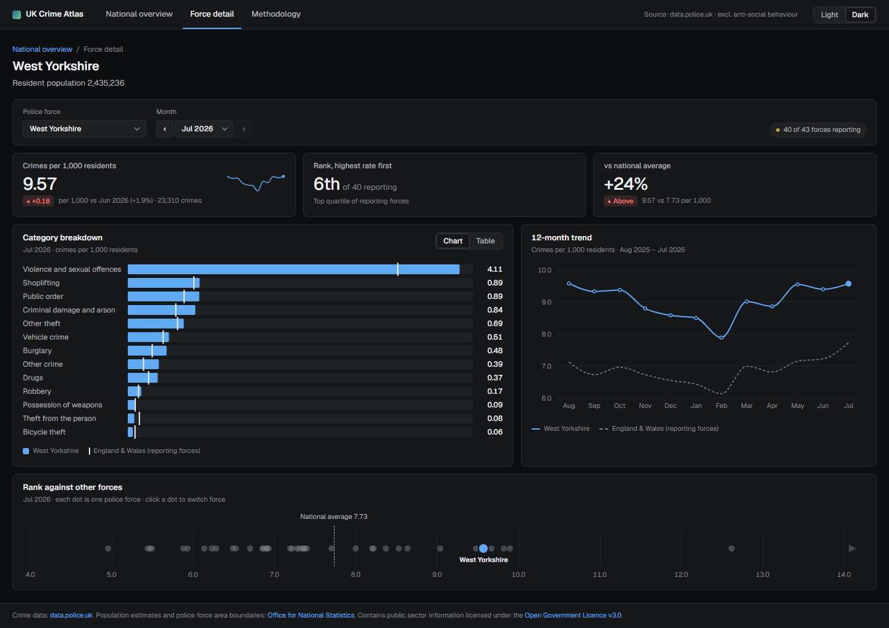
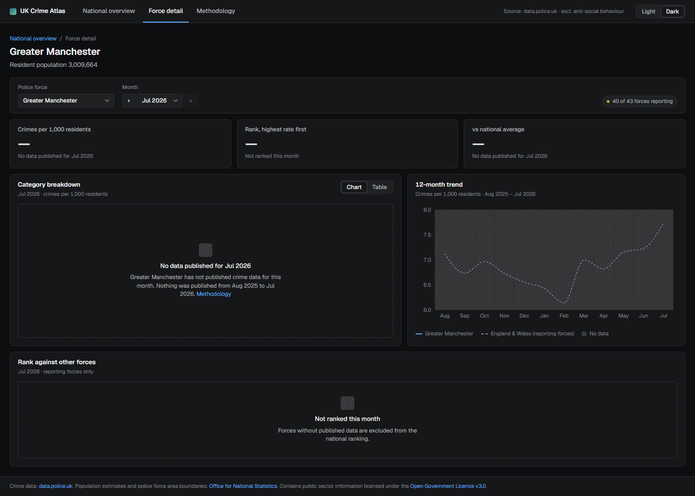
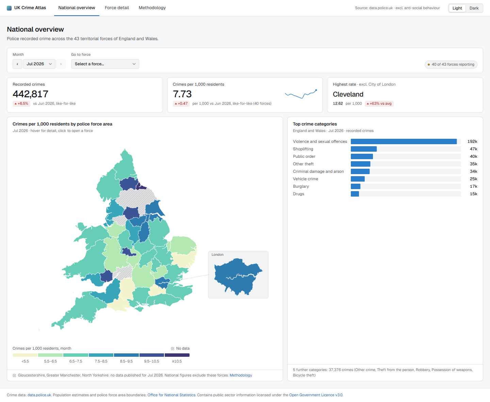
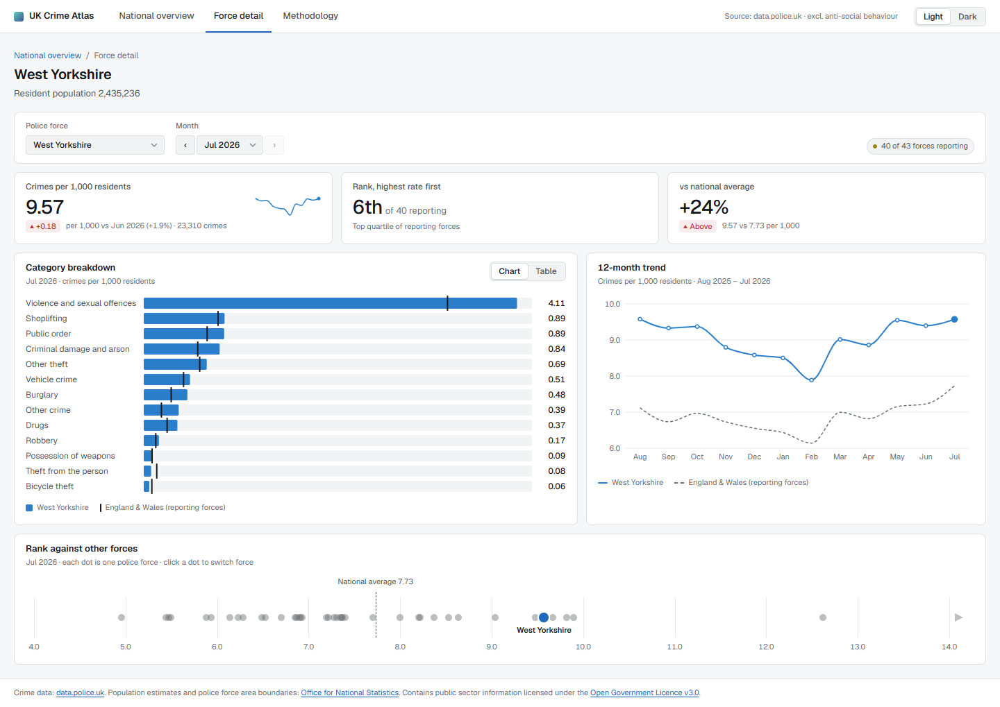
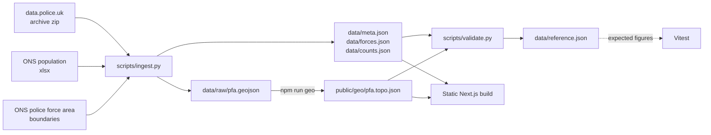

# UK Crime Atlas

A dashboard of police-recorded crime for the 43 territorial police forces of England and Wales:
a national choropleth map and a detail page per force, with every figure shown as a rate per
1,000 residents so that forces of very different sizes can be compared.

**Live:** https://uk-crime-atlas.vercel.app/



| Force detail | Force with no published data |
| --- | --- |
|  |  |

| Overview, light theme | Force detail, light theme |
| --- | --- |
|  |  |

## Features

- **National overview**: choropleth of crimes per 1,000 residents by police force area, with a London
  inset, legend and tooltip; KPI cards with a 12-month sparkline; crime categories chart.
- **Force detail** (one static page per force): rate, rank among reporting forces, comparison with
  the national average, category breakdown against the national rate (chart or table), 12-month
  trend against England & Wales, and a rank plot where every dot links to another force.
- **Month selector** kept in the URL (`?month=YYYY-MM`) and carried between pages.
- **Honest gaps**: a force-month with no data is shown as "no data", never as zero, and is left out
  of national figures, ranks and month-over-month changes.
- Light and dark themes, keyboard-accessible controls, layouts from 390px to desktop.
- Fully static: no API routes, no database, no client-side data fetching.

## Data sources and licence

| Data | Source |
| --- | --- |
| Crime | [data.police.uk](https://data.police.uk/data/) monthly street-level crime CSVs, latest 12 months in the archive (currently Aug 2025 – Jul 2026) |
| Population | [Office for National Statistics](https://www.ons.gov.uk/) population estimates for police force areas, mid-2024 |
| Boundaries | ONS Police Force Areas (December 2024), generalised (BGC), converted to TopoJSON |

Contains public sector information licensed under the
[Open Government Licence v3.0](https://www.nationalarchives.gov.uk/doc/open-government-licence/version/3/).
The data files in `data/` and `public/geo/` are derived from these sources and remain under that
licence. The code is under the [MIT licence](LICENSE).

## Methodology in brief

- **Rate** = recorded crimes ÷ resident population × 1,000, per force and month.
- **Anti-social behaviour** is excluded (it is not recorded crime). **British Transport Police** and
  the **Police Service of Northern Ireland** are excluded.
- A force-month with **no rows is missing**, not zero. A force-month below 50% of that force's median
  month is treated as an **incomplete** upload and excluded in the same way.
- **National rates, averages and ranks** use only the forces reporting that month, for both crimes
  and population. Ranks read "Nth of N reporting".
- **Month-over-month changes** are like-for-like: only forces reporting in both months.
- **Greater Manchester** has no street-level data in this window and always shows "no data".
- **City of London** is shown, but left out of the "highest rate" card and clipped on the rank plot:
  its small resident population inflates its rate.

The full version, including which force-months are missing and why, is on the
[`/methodology`](app/methodology/page.tsx) page of the app.

## Stack

- [Next.js](https://nextjs.org/) 16 (App Router), React 19, TypeScript strict; every page is static
- Map: `d3-geo` + `topojson-client` rendering SVG (no tiles, no map library)
- Charts: [Recharts](https://recharts.org/)
- Tests: [Vitest](https://vitest.dev/)
- Data pipeline: Python 3 + pandas, [mapshaper](https://github.com/mbloch/mapshaper) for the boundaries
- Hosting: Vercel

## Data pipeline



The raw downloads live in `data/raw/` and are not committed. The generated JSON and TopoJSON are
committed, so the app builds without Python.

## Run locally

Requires Node.js 24.

```bash
npm ci
npm run dev        # http://localhost:3000
npm run build      # production build
npm run start      # serve the production build
```

## Refresh the data

Requires Python 3.11 or newer. Commands are for Windows; use `.venv/bin/python` elsewhere.

1. Create the virtual environment (once):
   ```
   py -3.14 -m venv .venv
   .venv\Scripts\python -m pip install -r requirements.txt
   ```
2. In `scripts/ingest.py`, set `ARCHIVE_MONTH` to the newest month on
   [data.police.uk/data/archive](https://data.police.uk/data/archive/) and `ARCHIVE_SIZE` to that
   zip's size in bytes.
3. Download `https://policeuk-data.s3.amazonaws.com/archive/<ARCHIVE_MONTH>.zip` (about 1.7 GB) to
   `data/raw/`. `ingest.py` prints the URL and stops if the file is missing or the wrong size.
4. Rebuild and check:
   ```
   .venv\Scripts\python scripts\ingest.py      # ONS downloads + aggregation -> data/
   npm run geo                                 # boundaries -> public/geo/pfa.topo.json
   .venv\Scripts\python scripts\validate.py    # sanity checks, writes data/reference.json
   npm test
   npm run build
   ```
5. Commit `data/*.json` and `public/geo/pfa.topo.json`. The app always shows the latest 12 months
   in the archive and defaults to the newest.

To compare one force-month with its raw CSV:
`.venv\Scripts\python scripts\validate.py --spot kent 2026-06`

## Tests

```bash
npm test       # Vitest: lib/ (rates, deltas, ranks, missing-data handling, formatting, month URLs)
npm run lint
```

`lib/metrics.real.test.ts` checks the metrics against `data/reference.json`, which `validate.py`
computes independently in Python from the same data.

## Folder structure

```
app/           routes: / (overview), /force/[id], /methodology
components/    map, charts, cards, filter bar
lib/           data loading and metrics (rates, deltas, ranks); pure and tested
data/          generated JSON (committed); data/raw/ holds downloads (not committed)
public/geo/    pfa.topo.json
scripts/       ingest.py, validate.py, force_lookup.csv
design/        design export, reference only; never imported by the app
docs/          PLAN.md (phases and acceptance checks), screenshots
```

## How this was built

Built with [Claude Code](https://claude.com/claude-code) in five gated phases: scaffold and design
system, data pipeline, national overview, force detail and methodology, ship. `CLAUDE.md` fixes
the stack, data rules and conventions; `docs/PLAN.md` lists each phase with its acceptance checks.
Each phase was planned in plan mode, reviewed, implemented, and verified against its checks before
the next one started.
